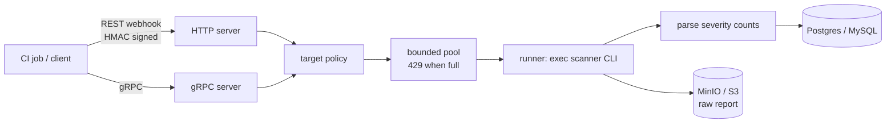

# automaton-sec

[](https://github.com/bryanwahyu/automaton-sec/actions/workflows/ci.yml)

A Go service that runs security scanners (Trivy, Nuclei, Gitleaks, Semgrep, osv-scanner, ZAP) on request, over REST or gRPC, and keeps the results: severity counts in Postgres or MySQL, the raw report in S3-compatible storage.

## Why

Every pipeline I worked on ran its scanners differently: one job calls Trivy, another runs Gitleaks with its own flags, the reports end up as CI artifacts that expire, and nobody can answer "how many high findings did this service have last month". I wanted one API that a CI job (or anything else) calls with `{"tool": "trivy", "image": "..."}`, which runs the scanner, normalises the result into the same severity counts for every tool, and stores both the counts and the original report per tenant.

## How it works



The code is split into `internal/domain` (scan entity, target policy, per-tool severity parsers), `internal/application` (use cases and the worker pool) and `internal/infra` (exec runner, DB adapters, MinIO, HTTP and gRPC servers). Both servers call the same application services. `pkg/sdk` is a small Go client for the REST API, and the gRPC contract lives in `proto/` with generated code in `gen/go`.

A scan request is saved as `running`, executed in the pool, then updated with counts, duration and the artifact URL, or with the error if the scanner failed. `GET /v1/{tenant}/scans` reads them back.

## Design decisions

**Scanners run as local processes, not containers.** The runner calls each tool with `os/exec`; the Docker image installs pinned versions of all of them (versions are build `ARG`s). Spawning one container per scan would isolate scanners better but needs a Docker socket inside the service, which I didn't want to hand to something that takes requests from CI. The trade-off is that the scanners share the service's filesystem and resources.

**A bounded pool that refuses instead of queueing.** Scanners use a lot of memory, so `scanner.maxConcurrent` caps how many run at once. When the pool is full the API returns `429` with `Retry-After` rather than putting the request in an unbounded queue. The caller has to retry, but the service can't be pushed into running out of memory, and the backlog is visible to the client.

**Targets are checked before anything runs.** A scanning API is an easy way to probe someone else's network, or your own cloud metadata endpoint. Hosts are resolved and loopback, link-local and private addresses are refused unless `allowPrivateTargets` is on; `allowedHosts` can restrict scanning to your own domains; filesystem scans must stay inside `workspaceRoot`; values starting with `-` are rejected so they can't become scanner flags. The server also refuses to start without credentials (HMAC key for the webhook, bearer keys for reads) unless `auth.disabled` is set explicitly. Trade-off: the scanner resolves the host again on its own, so there is a DNS-rebinding window between the check and the scan.

**REST and gRPC over the same use cases.** REST is what a CI webhook wants; gRPC adds `WatchScan`, a stream that pushes each status change until the scan finishes, so a client doesn't have to poll. Keeping both thin over `internal/application` means one implementation of the rules. `WatchScan` itself still polls the database every 2 seconds on the server side.

## Run it locally

Go 1.25+, Docker for Postgres and MinIO, and whichever scanners you want on your `PATH` (`GET /version` reports which ones it found). This uses Gitleaks because it's a single binary.

```bash
docker run -d --rm --name as-pg -e POSTGRES_USER=sec -e POSTGRES_PASSWORD=sec \
  -e POSTGRES_DB=security_db -p 55433:5432 postgres:16-alpine
docker run -d --rm --name as-minio -e MINIO_ROOT_USER=minioadmin -e MINIO_ROOT_PASSWORD=minioadmin \
  -p 59100:9000 quay.io/minio/minio server /data

# once Postgres is up
docker exec -i as-pg psql -U sec -d security_db < internal/infra/db/postgres/migration.sql

# filesystem scanners only read inside SCANNER_WORKSPACE_ROOT
export WS=$(mktemp -d)
git clone https://github.com/bryanwahyu/emailblast $WS/emailblast

SERVER_PORT=8080 DB_TYPE=postgres DB_HOST=127.0.0.1 DB_PORT=55433 DB_USER=sec DB_PASSWORD=sec DB_NAME=security_db PG_SSLMODE=disable \
MINIO_ENDPOINT=127.0.0.1:59100 MINIO_ACCESS_KEY=minioadmin MINIO_SECRET_KEY=minioadmin MINIO_BUCKET=security-scans \
AUTH_WEBHOOK_HMAC_KEY=devhmac AUTH_API_KEYS=devkey SCANNER_WORKSPACE_ROOT=$WS \
go run ./cmd/api
```

REST is on `:8080` here (the default `:5000` is taken by AirPlay Receiver on macOS), gRPC on `:9000`. From another shell with the same `$WS`, queue a scan (the webhook takes an HMAC-SHA256 of the body) and read it back:

```bash
body="{\"tool\":\"gitleaks\",\"path\":\"$WS/emailblast\"}"
sig=$(printf '%s' "$body" | openssl dgst -sha256 -hmac devhmac -hex | awk '{print $2}')
curl -s -X POST localhost:8080/v1/acme/webhook/security-scan \
  -H 'Content-Type: application/json' -H "X-Signature: $sig" -d "$body"

curl -s -H 'Authorization: Bearer devkey' localhost:8080/v1/acme/scans
```

Every setting can come from `config.yaml` (copy `config.yaml.example`, or point `CONFIG_PATH` at it) or from the environment variables listed at the top of that file; the environment wins.

Request fields per tool: `image` for `trivy`; `target` (URL) for `nuclei`, `zap`, `sqlmap`; `path` for `gitleaks`, `semgrep`, `osv-scanner`. Optional `source`, `branch`, `commit_sha` and `metadata` are stored with the scan.

### Endpoints

| Method | Path | |
|---|---|---|
| `GET` | `/health`, `/ready`, `/healthz`, `/metrics`, `/version` | probes, no auth |
| `POST` | `/v1/{tenant}/webhook/security-scan` | queue a scan (HMAC) |
| `POST` | `/v1/{tenant}/scans/{id}/retry` | re-run a scan |
| `GET` | `/v1/{tenant}/scans`, `/scans/latest`, `/scans/{id}`, `/scans/{id}/errors` | read scans (offset and cursor pagination) |
| `GET` | `/v1/{tenant}/summary?days=N` | severity rollup |
| `POST`/`GET` | `/v1/{tenant}/ai/analyze` | see Limitations |

gRPC exposes the same operations plus `WatchScan`, with reflection and the standard health service enabled:

```bash
grpcurl -plaintext -H 'authorization: Bearer devkey' localhost:9000 list
```

## Tests

```bash
go test -race ./...
go vet ./...
buf lint                     # proto contract
```

Tests cover the per-tool severity parsers (with a real osv-scanner fixture), the target policy, config loading, the worker pool, the scan service, the HTTP router and gRPC server against stubs, and the SDK's retry logic. CI runs gofmt, vet, build and race tests, lints the proto files and checks `gen/` is up to date, runs `govulncheck`, and builds the Docker image. Tagging `v*` builds a multi-arch image and creates a GitHub release.

## Limitations

- **The AI analysis endpoint doesn't see the scan.** It sends only the artifact URL to the OpenAI Chat Completions API, and the system prompt tells the model to infer risks from the file type and URL. The output reads plausibly but isn't based on the findings. Fixing it means downloading the report and sending its contents, within token limits. It also still calls OpenAI when no API key is configured.
- **SQLMap doesn't work as invoked.** The runner passes `--json -o <file>`; SQLMap has no `--json` option and `-o` turns on optimisation, so no report file is produced. SQLMap is also not installed in the Docker image.
- Semgrep is run with `--config auto --metrics off`. Recent Semgrep versions reject that combination; I haven't verified it here.
- `docker-compose.yml` runs only the API (plus Postgres for the Postgres variant). There is no MinIO or MySQL service, and the Postgres variant points MinIO at `localhost:9000`, which inside the container is the API's own gRPC port. Use the local steps above, or point the compose config at a real MinIO.
- Artifact URLs are plain object URLs, not presigned, so reading them depends on the bucket policy.
- Migrations are applied by hand; nothing runs them on startup.
- The compose file runs the containers as `root`.

## License

MIT
